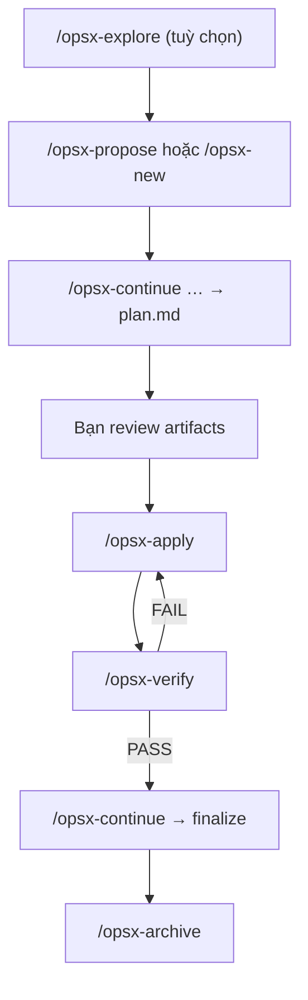

# OpenSpec workflows & Superpowers — Cheat sheet

Tài liệu tham chiếu nhanh cho **12 OpenSpec workflows** (`/opsx-*`) và chỗ **kết hợp Superpowers** trong Averie (schema `superspec`).

Liên quan: [advanced-workflow.md](./advanced-workflow.md) · [superpowers.md](./superpowers.md) · [overview.md](./overview.md)

---

## Hai lớp — đừng nhầm

| Lớp      | Ai lo                | Làm gì                                                            |
| -------- | -------------------- | ----------------------------------------------------------------- |
| **WHAT** | OpenSpec (`/opsx-*`) | Spec, proposal, tasks, verify, archive — ghi artifact markdown    |
| **HOW**  | Superpowers          | Brainstorm, plan chi tiết, TDD, worktree, subagent, debug, review |

`using-superpowers` **không phải bước riêng** — đó là meta-rule: trước mỗi phase, agent phải kiểm tra skill nào áp dụng. Bạn có thể nhắc thủ công (_"dùng brainstorming trước"_) hoặc để agent tự gọi.

---

## 12 workflows — lệnh, khi nào dùng

### 1. `explore` → `/opsx-explore`

**Là gì:** Chế độ **suy nghĩ** — đọc code, so sánh hướng, làm rõ yêu cầu. **Không implement code.**

**Khi dùng:** Chưa biết build gì; muốn khám phá trước khi cam kết change.

**Ví dụ:** `/opsx-explore auth nên JWT hay session?`

---

### 2. `propose` → `/opsx-propose`

**Là gì:** Tạo change **một lần** + sinh hết artifact planning (proposal, specs, design, tasks… theo schema).

**Khi dùng:** Đã rõ muốn build gì; muốn shortcut thay vì đi từng artifact.

**Ví dụ:** `/opsx-propose salon-booking-ui`

**Lưu ý:** Chỉ planning — **không code**. Implement phải `/opsx-apply` riêng.

---

### 3. `new` → `/opsx-new`

**Là gì:** Tạo change mới, bắt đầu **artifact đầu tiên** trong DAG (với superspec thường là `brainstorm`).

**Khi dùng:** Muốn đi **từng bước**, review từng file trước khi sang bước sau.

**Ví dụ:** `/opsx-new add-staff-schedule`

---

### 4. `continue` → `/opsx-continue`

**Là gì:** Tạo **artifact tiếp theo** trong DAG của change hiện tại.

**Khi dùng:** Sau `new`, hoặc sau khi review xong artifact vừa tạo.

**Ví dụ:** Đã có `proposal.md` → `/opsx-continue` → sinh `specs/` hoặc `tasks.md`…

**Quan trọng với superspec:** Sau `/opsx-verify` PASS → `/opsx-continue` → bước **finalize** (merge worktree, push, PR).

---

### 5. `ff` (fast-forward) → `/opsx-ff`

**Là gì:** `new` + `continue` lặp cho đến khi **sẵn sàng apply** — sinh hết planning artifacts một lượt.

**Khi dùng:** Đã rõ scope, muốn nhanh qua planning nhưng vẫn theo DAG.

**Ví dụ:** `/opsx-ff import-stitch-screens`

---

### 6. `apply` → `/opsx-apply`

**Là gì:** **Implement code** theo `tasks.md` / `plan.md`. Ghi `apply.md` (receipt: branch, iteration, commit range).

**Khi dùng:** Bạn đã review xong planning artifacts.

**Ví dụ:** `/opsx-apply salon-platform-backend-init`

---

### 7. `update` → `/opsx-update`

**Là gì:** **Sửa lại planning artifacts** (proposal, specs, tasks…) khi scope đổi — **không sửa code**.

**Khi dùng:** Giữa chừng phát hiện thiếu requirement; muốn chỉnh spec trước khi apply tiếp.

**Khác `continue`:** `continue` = tạo artifact **mới** chưa có; `update` = **sửa** artifact đã có cho coherent.

---

### 8. `sync` → `/opsx-sync`

**Là gì:** Gộp **delta specs** (`openspec/changes/<name>/specs/`) vào **main specs** (`openspec/specs/`).

**Khi dùng:** Trước archive (nếu chưa sync), hoặc khi muốn cập nhật spec chính thủ công.

**Lưu ý:** `/opsx-archive` thường tự sync; `sync` riêng khi bạn muốn kiểm soát merge.

---

### 9. `verify` → `/opsx-verify`

**Là gì:** 5 checks sau implement:

1. `openspec validate --all`
2. `tasks.md` đã tick hết (`- [x]`)
3. Delta specs vs main specs
4. `design.md` vs specs (drift warning)
5. Code đã commit, không còn unstaged

Ghi kết quả vào `verify.md` → **PASS** / **PASS WITH WARNINGS** / **FAIL**.

**Khi dùng:** Sau `/opsx-apply`, trước finalize/archive.

**Vòng lặp:** FAIL do code → quay lại `/opsx-apply` → `/opsx-verify` lại (tối đa ~5 iteration).

---

### 10. `archive` → `/opsx-archive`

**Là gì:** **Đóng change** — sync specs, move vào `openspec/changes/archive/`, dọn active change.

**Khi dùng:** Verify PASS (+ finalize xong nếu dùng superspec v4).

---

### 11. `bulk-archive` → `/opsx-bulk-archive`

**Là gì:** Archive **nhiều change** cùng lúc.

**Khi dùng:** Dọn nhiều change cũ đã xong; ít dùng hàng ngày.

---

### 12. `onboard` → `/opsx-onboard`

**Là gì:** **Tutorial có hướng dẫn** — chạy một vòng OpenSpec đầy đủ trong repo, giải thích từng bước.

**Khi dùng:** Lần đầu học workflow; không phải luồng production.

---

## Superspec DAG (artifact trong change)

OpenSpec workflows điều khiển **lệnh slash**; superspec định nghĩa **artifact** bên trong `openspec/changes/<name>/`:

```text
brainstorm → proposal → design? → specs → tasks → plan → apply → verify → finalize → archive
```

| Artifact   | File            | Superpowers (superspec)                                                                          |
| ---------- | --------------- | ------------------------------------------------------------------------------------------------ |
| brainstorm | `brainstorm.md` | `brainstorming`                                                                                  |
| proposal   | `proposal.md`   | — (OpenSpec WHAT)                                                                                |
| design     | `design.md`     | — (optional)                                                                                     |
| specs      | `specs/**/*.md` | —                                                                                                |
| tasks      | `tasks.md`      | —                                                                                                |
| plan       | `plan.md`       | `writing-plans`                                                                                  |
| apply      | `apply.md`      | `using-git-worktrees`, `subagent-driven-development`, TDD (transitive), code review (transitive) |
| verify     | `verify.md`     | `verification-before-completion` (bổ sung)                                                       |
| finalize   | `finalize.md`   | Schema tự git closeout; `finishing-a-development-branch` = escape hatch                          |

`/opsx-archive` **không nằm trong DAG** — chạy sau finalize.

---

## Workflow khuyến nghị (Averie)

### Luồng đầy đủ (review từng bước)

```text
/opsx-explore          (tuỳ chọn)
/opsx-new ten-change
/opsx-continue         (lặp đến khi có plan.md)
→ BẠN review proposal / specs / tasks / plan
/opsx-apply
/opsx-verify
/opsx-continue         (finalize — sau verify PASS)
/opsx-archive
```

### Shortcut (đã rõ scope)

```text
/opsx-propose ten-change   hoặc   /opsx-ff ten-change
→ review
/opsx-apply → /opsx-verify → /opsx-continue → /opsx-archive
```

### Sơ đồ



---

## Kết hợp Superpowers — bảng tra nhanh

| Phase OpenSpec           | Lệnh                              | Superpowers                                                   | Ghi chú                                                       |
| ------------------------ | --------------------------------- | ------------------------------------------------------------- | ------------------------------------------------------------- |
| Khám phá                 | `/opsx-explore`                   | `brainstorming`                                               | Explore = stance OpenSpec; brainstorming = cấu trúc 2–3 hướng |
| Brainstorm artifact      | `/opsx-continue`                  | **`brainstorming`**                                           | Superspec bắt buộc                                            |
| Proposal / specs / tasks | `/opsx-propose`, `/opsx-continue` | _(thường không)_                                              | Bạn review tay                                                |
| Plan artifact            | `/opsx-continue` (plan)           | **`writing-plans`**                                           | Micro-step 2–5 phút                                           |
| UI (Averie)              | Trước apply UI                    | **`ui-ux-pro-max`**                                           | Skill riêng trong `.cursor/skills/`                           |
| Implement                | `/opsx-apply`                     | **`using-git-worktrees`** → **`subagent-driven-development`** | Superspec apply                                               |
| Trong apply              | (tự động)                         | **`test-driven-development`**                                 | Transitive qua subagent                                       |
| Trong apply              | (tự động)                         | **`requesting-code-review`**                                  | Transitive sau implement                                      |
| Bug / test fail          | Giữa apply                        | **`systematic-debugging`**                                    | Không thay verify                                             |
| Task song song           | Apply lớn                         | **`dispatching-parallel-agents`**                             | ≥ 2 task độc lập                                              |
| Trước nói "xong"         | `/opsx-verify`                    | **`verification-before-completion`**                          | + `pnpm type-check`, `pnpm lint`                              |
| Finalize                 | `/opsx-continue`                  | _(schema git closeout)_                                       | `finishing-a-development-branch` = escape hatch               |
| Nhận review PR           | Sau PR                            | **`receiving-code-review`**                                   | Kiểm chứng feedback trước khi sửa                             |
| Mọi session              | Đầu chat / đổi phase              | **`using-superpowers`**                                       | Meta: check skill trước khi hành động                         |

---

## `using-superpowers` — khi nào gọi?

Không cần gõ `/using-superpowers` mỗi bước. Dùng theo **cổng phase**:

1. **Bắt đầu feature mới** → nhắc _"dùng brainstorming"_ hoặc `/opsx-explore`
2. **Trước code đa bước** → _"writing-plans"_ (thường qua artifact `plan.md`)
3. **Bắt đầu implement** → `/opsx-apply` (worktree + subagent + TDD đã embed trong superspec)
4. **Gặp bug** → _"systematic-debugging"_
5. **Sắp nói xong** → `/opsx-verify` + `verification-before-completion`
6. **Agent nhảy code không qua spec** → _"Dừng. Làm theo superspec / using-superpowers trước."_

---

## Hay dùng vs hiếm dùng

| Hay dùng                                           | Hiếm / đặc biệt                   |
| -------------------------------------------------- | --------------------------------- |
| explore, propose, apply, verify, archive, continue | onboard (học lần đầu)             |
| update (khi đổi scope)                             | bulk-archive (dọn hàng loạt)      |
| sync (thủ công nếu cần)                            | ff (khi đã quen propose/continue) |
| new + continue (review từng artifact)              |                                   |

---

## Không cần OpenSpec change

Theo superspec / Averie conventions — làm trực tiếp PR:

- Typo docs, chore tooling nhỏ
- Bug fix **khôi phục** hành vi đã spec
- Bump dependency không breaking
- Thêm/backfill tests không đổi behavior

---

## Cài đặt & cập nhật lệnh

Profile **core** (mặc định) chỉ có 6 workflow — **không có** verify, continue, new, ff…

Profile **custom expanded** (12 workflow) — cấu hình global rồi sync project:

```bash
openspec config profile          # interactive — tick thêm verify, continue, …
openspec update                  # trong thư mục project
```

Config global: `%APPDATA%\openspec\config.json` (Windows).

Sau cập nhật: **restart Cursor** để slash commands mới hiện.

---

## Ví dụ thực tế

```text
# Change backend đã implement:
/opsx-verify salon-platform-backend-init

# PASS → finalize:
/opsx-continue salon-platform-backend-init

# Đóng change:
/opsx-archive salon-platform-backend-init
```

Khi có UI, trước `/opsx-apply`:

```text
@openspec/changes/<name>/proposal.md
@openspec/changes/<name>/tasks.md

Dùng UI/UX Pro Max chọn design system (Next.js + Tailwind + theme Averie),
rồi implement theo Superpowers TDD.
```

---

## Liên kết

| Tài nguyên                | Path / URL                                     |
| ------------------------- | ---------------------------------------------- |
| Quy trình nâng cao Averie | [advanced-workflow.md](./advanced-workflow.md) |
| Superpowers skills        | [superpowers.md](./superpowers.md)             |
| Superspec integration     | `openspec/schemas/superspec/INTEGRATION.md`    |
| OpenSpec CLI              | https://openspec.dev                           |
| Config project            | `openspec/config.yaml`                         |
